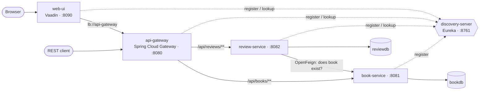

# Bookstore Microservices

[](https://github.com/payallenka/Microservices/actions/workflows/ci.yml)


A book catalogue with reader reviews, built as a set of Spring Boot microservices. Services find each
other through **Eureka**, external traffic enters through a **Spring Cloud Gateway**, services call each
other with **OpenFeign**, and each service owns its own **PostgreSQL** database with **Flyway** migrations.
The whole stack starts with a single `docker compose up`.

## Architecture



| Service | Responsibility | Key tech |
|---|---|---|
| `discovery-server` | Service registry; every other service registers here | Eureka Server |
| `api-gateway` | Single entry point; routes `/api/books/**` and `/api/reviews/**` to healthy instances | Spring Cloud Gateway, LoadBalancer |
| `book-service` | Book catalogue CRUD, search and pagination | Spring MVC, Spring Data JPA, PostgreSQL, Flyway |
| `review-service` | Reviews and average ratings; checks the book exists in `book-service` before saving | OpenFeign, Spring Data JPA, PostgreSQL, Flyway |
| `web-ui` | UI to browse, search, edit books and add reviews; calls the gateway by service name | Vaadin 24, `@LoadBalanced` RestClient |

## Highlights

- **Layered design**: controller → service → repository, with request/response DTOs (Java records) so JPA entities never leak into the API.
- **Validation and consistent errors**: Bean Validation on every request; all errors are returned as [RFC 7807 Problem Details](https://www.rfc-editor.org/rfc/rfc7807) with the right status code (400 with per-field errors, 404, 409 duplicate ISBN, 503 when a downstream service is down).
- **Database per service**: `bookdb` and `reviewdb` are separate; schemas are versioned with Flyway and Hibernate only validates them (`ddl-auto: validate`).
- **Real service discovery**: no hard-coded hosts. The gateway uses `lb://` routes, `review-service` uses a Feign client, and `web-ui` uses a `@LoadBalanced` `RestClient`, all resolved through Eureka.
- **Resilient inter-service call**: Feign timeouts are configured, and failures are translated into 404 (unknown book) or 503 (book-service unavailable) instead of a 500.
- **Tests at three levels**: Mockito unit tests, `@WebMvcTest` controller tests, and `@SpringBootTest` integration tests against a real PostgreSQL started by **Testcontainers**.
- **Container-ready**: one multi-stage `Dockerfile` builds every service from source and runs it as a non-root user. Compose healthchecks start services in dependency order.
- **CI**: GitHub Actions runs the full test suite and builds every Docker image on each push and pull request.
- **API docs**: OpenAPI 3 / Swagger UI generated by springdoc for each backend service.

## Getting started

**Prerequisites:** Docker with Compose v2. Java and Maven are only needed to run the tests outside Docker.

```bash
git clone https://github.com/payallenka/Microservices.git
cd Microservices
docker compose up --build
```

First start takes a few minutes while the images build. Then open:

| What | URL |
|---|---|
| Web UI | http://localhost:8090 |
| API via gateway | http://localhost:8080/api/books |
| Eureka dashboard | http://localhost:8761 |
| Swagger UI: books | http://localhost:8081/swagger-ui.html |
| Swagger UI: reviews | http://localhost:8082/swagger-ui.html |

The book catalogue is seeded with a few titles by a Flyway migration. Stop the stack with
`docker compose down` (add `-v` to also delete the database volume).

## API

All requests go through the gateway on port `8080`.

### Books

| Method | Path | Description | Success |
|---|---|---|---|
| `GET` | `/api/books?search=&page=&size=&sort=` | List or search (title, author, publisher), paginated | 200 |
| `GET` | `/api/books/{id}` | Get one book | 200 |
| `POST` | `/api/books` | Create a book | 201 + `Location` |
| `PUT` | `/api/books/{id}` | Replace a book's details | 200 |
| `DELETE` | `/api/books/{id}` | Delete a book | 204 |

### Reviews

| Method | Path | Description | Success |
|---|---|---|---|
| `GET` | `/api/reviews?bookId=` | Reviews for a book, newest first | 200 |
| `GET` | `/api/reviews/summary?bookId=` | Review count and average rating | 200 |
| `POST` | `/api/reviews` | Add a review (book must exist) | 201 + `Location` |
| `DELETE` | `/api/reviews/{id}` | Delete a review | 204 |

### Examples

```bash
# Create a book
curl -i -X POST http://localhost:8080/api/books \
  -H 'Content-Type: application/json' \
  -d '{"title":"Java Concurrency in Practice","author":"Brian Goetz","publisher":"Addison-Wesley","isbn":"9780321349606"}'

# Search
curl 'http://localhost:8080/api/books?search=java&sort=title,asc'

# Review it (use the id returned above)
curl -X POST http://localhost:8080/api/reviews \
  -H 'Content-Type: application/json' \
  -d '{"bookId":6,"reviewer":"Ada","rating":5,"comment":"Must read"}'

curl 'http://localhost:8080/api/reviews/summary?bookId=6'
```

Validation error response:

```json
{
  "type": "about:blank",
  "title": "Bad Request",
  "status": 400,
  "detail": "Validation failed",
  "instance": "/api/books",
  "errors": { "isbn": "must be a valid ISBN-10 or ISBN-13 (digits only)" }
}
```

## Running the tests

The integration tests start PostgreSQL with Testcontainers, so Docker must be running.

```bash
./mvnw verify                   # every service
./mvnw verify -pl book-service  # a single service
```

38 automated tests across the services:

| Service | Unit (Mockito) | Web layer (`@WebMvcTest` / MockRestServiceServer) | Integration (Testcontainers PostgreSQL) |
|---|---|---|---|
| book-service | 9 | 7 | 2 (Flyway seed data, full CRUD lifecycle, unique-ISBN conflict) |
| review-service | 6 | 6 | 2 (persist + rating summary, unknown book rejected) |
| web-ui | – | 4 (API client, error mapping) | – |
| api-gateway | – | – | 1 (route configuration) |
| discovery-server | – | – | 1 (context starts) |

## Troubleshooting

- **`Bind for 0.0.0.0:8761 failed: port is already allocated`**: another process or container is using one of the ports (8761, 8080, 8081, 8082, 8090). Stop it, or change the left-hand side of that service's `ports:` mapping in `docker-compose.yml`, for example `"18761:8761"`.
- **Reviews return 503**: `book-service` is down or still starting. Reading existing reviews keeps working, and `docker compose ps` shows each service's health.
- **Services missing from the Eureka dashboard right after startup**: registration takes up to about 30 seconds; the gateway returns 503 for a service until it appears.

## Project structure

```
.
├── discovery-server/      Eureka registry
├── api-gateway/           Spring Cloud Gateway routes
├── book-service/
│   └── src/main/java/com/bookstore/book/
│       ├── controller/    REST endpoints
│       ├── service/       business rules and transactions
│       ├── repository/    Spring Data JPA
│       ├── entity/        JPA entities
│       ├── dto/           request/response records
│       └── exception/     domain exceptions + ProblemDetail handler
├── review-service/        same layout, plus client/ (OpenFeign client for book-service)
├── web-ui/                Vaadin views and a typed API client
├── infra/postgres/init/   creates one database per service
├── Dockerfile             multi-stage build shared by all services
├── docker-compose.yml     full stack with healthchecks
└── pom.xml                Maven aggregator (./mvnw verify builds everything)
```

## Design decisions and trade-offs

- **Synchronous existence check for reviews.** `review-service` asks `book-service` whether a book exists before saving a review. This is simple and consistent, but it couples availability: if `book-service` is down, new reviews are rejected with 503 while reading reviews keeps working. An event-driven alternative is listed below.
- **No foreign key across services.** `reviews.book_id` is a plain column because the two services have separate databases. Deleting a book does not cascade to its reviews yet.
- **Backend services publish their ports** (8081, 8082) only so Swagger UI is easy to reach locally. In production only the gateway would be exposed.

## Possible next steps

- Publish `BookDeleted` events (Kafka or RabbitMQ) so `review-service` can clean up reviews asynchronously.
- Add Resilience4j circuit breakers and retries around the Feign client.
- Secure the gateway with OAuth2 / JWT (Spring Security, Keycloak).
- Add distributed tracing (Micrometer Tracing + Zipkin) and centralised configuration (Spring Cloud Config).
- Deploy to Kubernetes with Helm charts.

## Author

**Payal Lenka**: [GitHub](https://github.com/payallenka)
